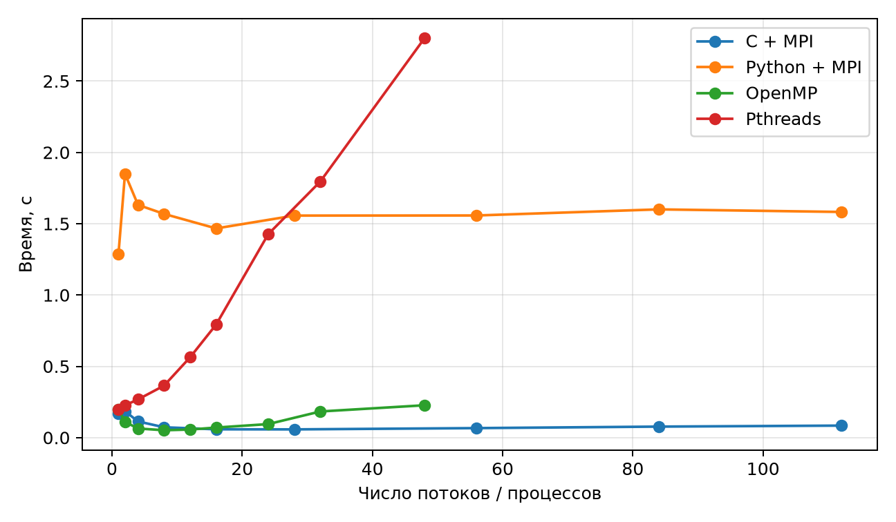
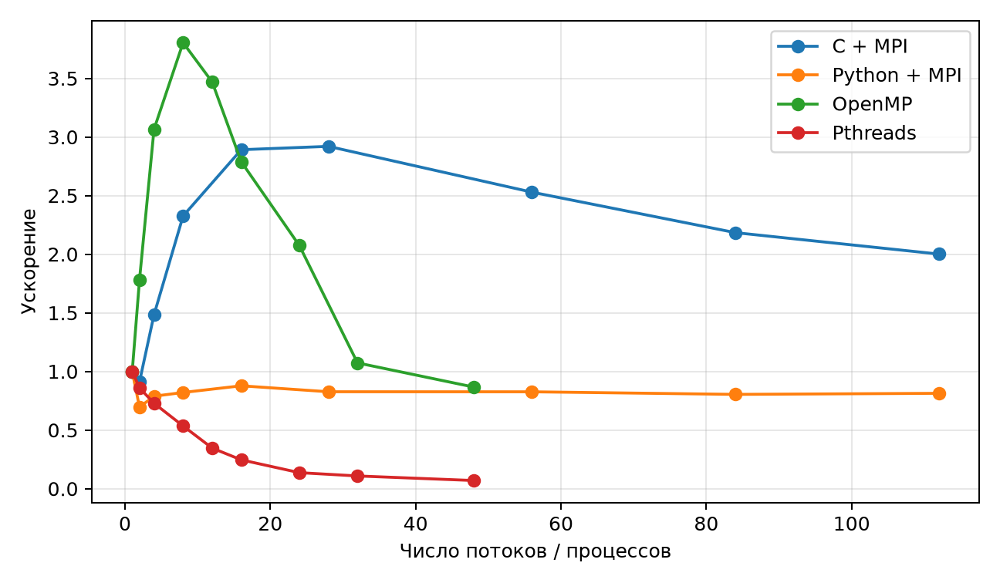

# Parallel solution of banded SLAE

Лабораторная работа по параллельному программированию, вариант 11.

Проект реализует специализированный метод Гаусса для симметричных строго
диагонально преобладающих ленточных матриц. Матрица хранится в ленточном
формате, поэтому требуется `O(n * bw)` памяти, а вычислительная сложность
составляет `O(n * bw^2)`.

## Реализации

- C + POSIX Threads: `src/band_pthreads.c`;
- C + OpenMP: `src/band_openmp.c`;
- C + MPI: `src/band_mpi.c`;
- Python + MPI: `src/band_mpi.py`, `mpi4py` и NumPy.

Все реализации формируют одинаковую тестовую систему по параметрам `N`, `BW`
и `SEED`. Точное решение известно заранее, поэтому после вычисления программа
выводит время, относительную невязку и относительную ошибку.

## Структура проекта

```text
src/       исходные тексты реализаций
scripts/   настройка окружения, сбор результатов и построение графиков
slurm/     пакетные задания Slurm
tests/     проверка корректности
results/   итоговые CSV-файлы эксперимента
report/    отчёт и графики
```

## Сборка на кластере

```bash
git clone https://github.com/roilehtin/parallel-banded-slae.git
cd parallel-banded-slae
bash scripts/build_cluster.sh
```

Сценарий подключает GCC 11, OpenMPI 4.1.6 и Python 3.10, после чего собирает
исполняемые файлы в каталоге `bin`.

## Проверка корректности

На выделенном вычислительном узле:

```bash
source scripts/env_cluster.sh
bash tests/run_correctness.sh
```

Проверяются четыре реализации на системе `N=128`, `BW=5`, `SEED=42` и четырёх
исполнителях. Допустимая относительная ошибка и невязка равны `1e-10`.

## Пакетный эксперимент Slurm

```bash
sbatch slurm/threads.sbatch
sbatch slurm/mpi_c.sbatch
sbatch slurm/mpi_python.sbatch
squeue -u "$USER"
```

Потоковые реализации исследуются на одном узле с числом потоков до 48.
MPI-реализации исследуются на двух узлах с числом процессов до 112.

Размер задачи и число повторов можно изменить при отправке:

```bash
sbatch --export=ALL,N=6000,BW=96,SEED=42,REPEATS=3 slurm/threads.sbatch
```

## Обработка результатов

```bash
python3 scripts/aggregate.py logs results/benchmark.csv
python3 scripts/plot_results.py results/benchmark.csv report/figures
```

`aggregate.py` собирает CSV-строки из журналов Slurm и выбирает минимальное
время для каждой конфигурации. `plot_results.py` строит графики времени и
ускорения.

## Результаты

Для использованной тестовой системы лучший результат показала OpenMP-версия:
`0.0517` секунды при восьми потоках. C + MPI достигла `0.0578` секунды на 28
процессах. Все реализации прошли проверку корректности с ошибкой порядка
`1e-16`.





Полный отчёт: [report/report.pdf](report/report.pdf).

